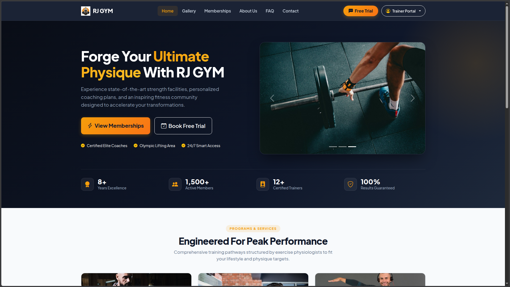
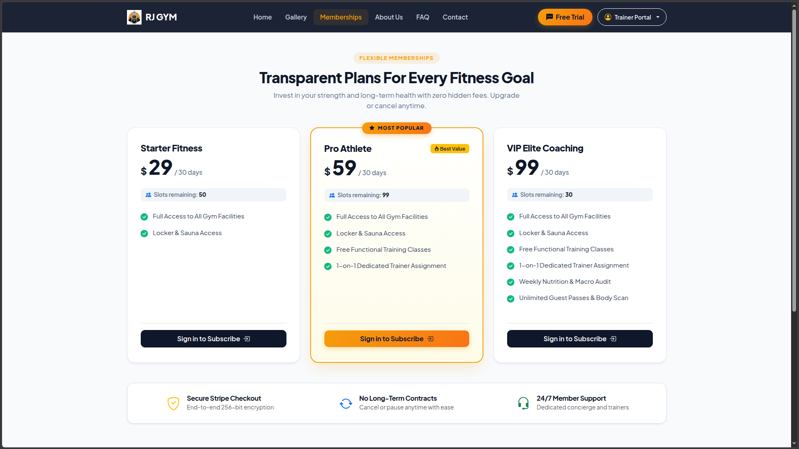
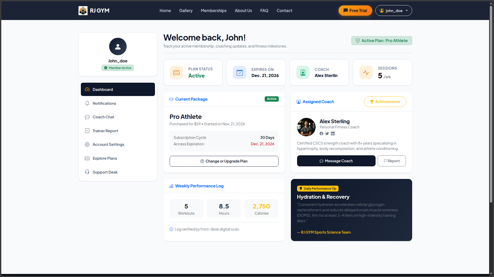
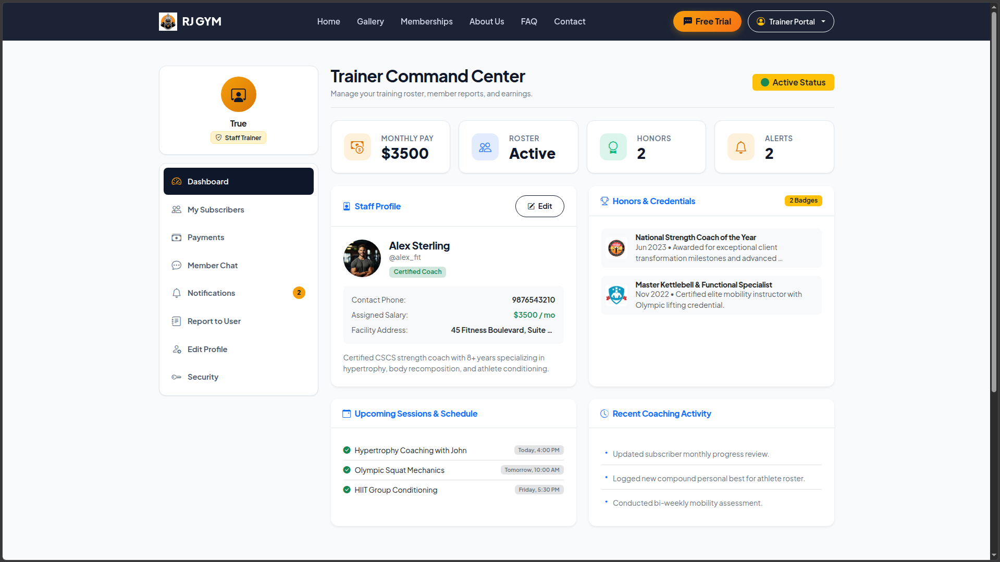

# Gym Management System (GMS)

A full-stack fitness management web platform built with Django and Django Channels. The system provides role-based portals for gym members and trainers, subscription tier management with Stripe payment processing, and real-time communication via WebSockets.

---

## Key Screenshots

### Landing Page & Facility Overview


### Membership Plans & Pricing Matrix


### Member Dashboard


### Trainer Management Portal


---

## Core Capabilities

### Public Portal
- Dynamic landing page showcasing gym services, equipment highlights, and facility photo albums.
- Tiered membership pricing matrix with automated term-based discount calculations.
- Integrated visitor enquiry and trial pass booking system.
- Searchable FAQ knowledge base and interactive facility location map.

### Member Portal
- Personal dashboard displaying active subscription status, validity duration, and assigned trainer.
- Direct real-time messaging with assigned fitness coach via WebSockets.
- Formal progress reporting interface for training feedback and diet check-ins.
- Account settings with credential management and notification preferences.

### Trainer Portal
- Dedicated staff dashboard with active subscriber roster and compensation statements.
- Direct member communication channel with subscriber dropdown switcher.
- Real-time notification dispatch powered by WebSocket consumer groups.
- Credentials portfolio displaying certifications, awards, and specialization badges.

### Payment & Administration
- Stripe payment integration with dynamic checkout sessions.
- Role-based access control separating members, trainers, and site administrators.
- Enhanced administration dashboard configured via Django Jazzmin.

---

## Tech Stack

| Layer | Technologies |
|---|---|
| **Backend** | Python 3, Django 5, ASGI (Daphne) |
| **Real-time** | Django Channels, WebSockets (InMemory / Redis) |
| **Database** | SQLite (Default / Development), PostgreSQL (Production-ready) |
| **Frontend** | HTML5, CSS3, Bootstrap 5, JavaScript, jQuery |
| **Integrations** | Stripe API, Django Crispy Forms, Lightbox2 |

---

## Getting Started

### 1. Prerequisites
- Python 3.10+
- Git

### 2. Clone the Repository
```bash
git clone https://github.com/your-username/Gym-Management-System---Django.git
cd Gym-Management-System---Django
```

### 3. Create Virtual Environment & Install Dependencies
```bash
# Create virtual environment
python3 -m venv .venv

# Activate virtual environment:
# On Linux / macOS:
source .venv/bin/activate

# On Windows (Command Prompt):
# .venv\Scripts\activate.bat

# On Windows (PowerShell):
# .venv\Scripts\Activate.ps1

# Install dependencies
pip install -r requirements.txt
```

*(Optional with `uv`: `uv venv && uv pip install -r requirements.txt`)*

### 4. Database Setup & Seeding
```bash
python manage.py migrate
python seed_data.py
```

### 5. Run Development Server
```bash
python manage.py runserver
```
Navigate to `http://127.0.0.1:8000` in your browser.

---

## Demo Credentials

The included seeding script (`seed_data.py`) automatically provisions sample accounts:

| Portal | Username | Password |
|---|---|---|
| **Admin Panel** (`/admin`) | `admin` | `admin123` |
| **Member Portal** (`/Login`) | `john_doe` | `password123` |
| **Trainer Portal** (`/Trainer-Login`) | `alex_fit` | `trainer123` |

---

## License

This project is licensed under the MIT License. See [LICENSE.txt](LICENSE.txt) for details.
